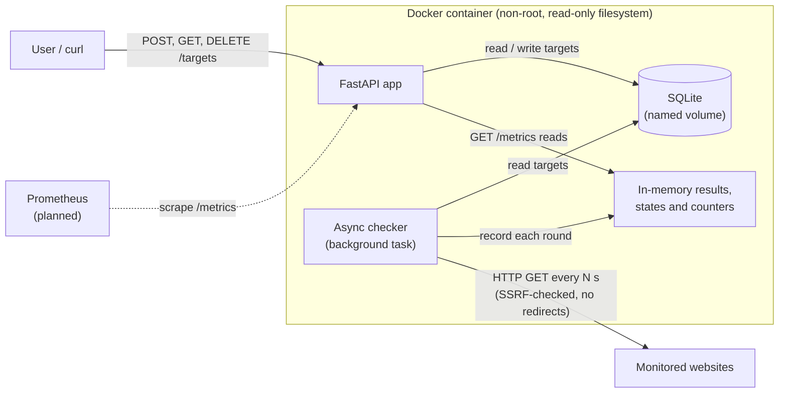

# site-monitor

[](https://github.com/RomainBoland/site-monitor/actions/workflows/ci.yml)

A small service that checks whether websites are up and exposes the results as **Prometheus metrics**.

You register URLs through a JSON API. A background checker requests them periodically and records up/down, HTTP status and response time. A site is reported **DOWN only after several consecutive failures**, so a single timeout doesn't cause an alert. User-supplied URLs are protected against **SSRF**: anything that resolves to localhost or a private network is refused.

Every technical choice is documented in an [Architecture Decision Record](#decision-records) explaining the options considered, the trade-offs, and when I would choose differently.

## Architecture



- **API**: FastAPI. Validates and normalises URLs, rejects URLs with credentials and SSRF attempts, and stores targets in SQLite.
- **Checker**: an `asyncio` task started with the app. Every `CHECK_INTERVAL_SECONDS` it requests all targets concurrently (capped by `CHECK_CONCURRENCY`):
  - it re-runs the SSRF check before each request, because DNS can change after registration;
  - it does not follow redirects, and it never downloads response bodies.
- **State machine**: `UNKNOWN`, `UP`, `DOWN`. A target becomes DOWN after `FAILURE_THRESHOLD` consecutive failures and UP again after one success. UP↔DOWN changes are logged and counted, which is the basis for future alerts.
- **Metrics**: built at scrape time from the in-memory data, in the Prometheus text format.

**Planned next** (not built yet): Prometheus and Grafana with alert rules, an HTTPS reverse proxy, deployment to a VPS with Docker Compose from GitHub Actions.

## Quick start

### With Docker (recommended)

Requires Docker with the Compose plugin.

```bash
cp .env.example .env   # optional: adjust settings
make up                # build the image and start the container
curl -X POST http://127.0.0.1:8000/targets \
     -H 'Content-Type: application/json' -d '{"url": "https://www.python.org"}'
curl http://127.0.0.1:8000/metrics
make down              # stop (the database is kept in the site-monitor-data volume)
```

The service listens on `127.0.0.1:8000` only, because the API and `/metrics` have no authentication. Interactive API docs are at http://127.0.0.1:8000/docs.

### For development

Requires [uv](https://docs.astral.sh/uv/). It installs the pinned Python (3.13) and the exact dependency versions from `uv.lock`.

```bash
uv sync        # create .venv
make lint      # ruff lint + format check (same as CI)
make format    # auto-fix and format the code
make test      # run the tests (no network needed)
make run       # start the API with auto-reload on http://127.0.0.1:8000
```

## API

| Method and path | Description | Responses |
|---|---|---|
| `POST /targets` | Register `{"url": "https://..."}` | `201` created, `409` already exists, `422` invalid URL, credentials in URL, or non-public/unresolvable host |
| `GET /targets` | List targets | `200` |
| `DELETE /targets/{id}` | Remove a target | `204` deleted, `404` unknown id |
| `GET /health` | Liveness check: is the process up? It does not check the monitored sites | `200 {"status": "ok"}` |
| `GET /metrics` | Prometheus metrics | `200` text format |

## Configuration

All settings are environment variables ([12-factor](https://12factor.net/config)), documented in [.env.example](.env.example). Invalid values stop the application at startup.

| Variable | Default | Description |
|---|---|---|
| `DATABASE_PATH` | `site-monitor.db` (`/data/site-monitor.db` in Docker) | SQLite database file |
| `CHECK_INTERVAL_SECONDS` | `30` | Time between two check rounds |
| `CHECK_TIMEOUT_SECONDS` | `10` | Timeout of one request |
| `CHECK_CONCURRENCY` | `10` | Maximum requests in flight at once |
| `FAILURE_THRESHOLD` | `3` | Consecutive failures before a target is DOWN |

With the defaults, an outage is reported 60 to 90 seconds after it starts.

## Metrics

| Metric | Type | Labels | Meaning |
|---|---|---|---|
| `site_monitor_target_up` | gauge | `target_id`, `url` | 1 = UP, 0 = DOWN; absent while the state is unknown |
| `site_monitor_response_time_seconds` | gauge | `target_id`, `url` | Time to response headers, latest check |
| `site_monitor_http_status` | gauge | `target_id`, `url` | HTTP status of the latest check |
| `site_monitor_checks_total` | counter | `result` (`success`, `failure`) | Checks performed |
| `site_monitor_state_changes_total` | counter | `state` (`up`, `down`) | UP↔DOWN transitions |

Example alert rule for later: `site_monitor_target_up == 0`. Labels are kept to bounded values. Error messages go to the logs, never into labels, to avoid a cardinality explosion.

## Security

- **SSRF protection**: the hostname is resolved and **every** resulting IP must be globally routable (an allowlist). This rejects loopback, private ranges, link-local and cloud metadata (`169.254.169.254`), carrier-grade NAT, and encodings like `2130706433` or `::ffff:127.0.0.1`. The check runs at registration and before every request, and redirects are not followed.
- **Input validation**: only `http`/`https`, a length limit, normalised URLs, no `user:password@`. All SQL uses placeholders.
- **Container**: multi-stage build without dev tools, non-root user, read-only root filesystem, all Linux capabilities dropped, `no-new-privileges`, port bound to localhost.
- **CI**: read-only token, no persisted credentials, third-party actions pinned by full commit SHA.

## Project layout

```
site_monitor/
  main.py      FastAPI app: lifespan (startup/shutdown), endpoints, logging
  db.py        SQLite storage (plain SQL, stdlib sqlite3)
  ssrf.py      Resolve host and allow only public IPs
  checker.py   Async checks, scheduling loop, settings, recording rounds
  state.py     UNKNOWN/UP/DOWN state machine (pure function)
  metrics.py   Prometheus collector for /metrics
tests/         pytest suite, using a fake DNS and a mock HTTP transport (no network)
docs/          Roadmap and decision records
```

## Known limitations

- **Single instance only**: the checker runs inside the API process, so several workers or replicas would check every site several times and expose inconsistent metrics. Scaling would mean moving the checker to its own container ([007](docs/decisions/007-checker-httpx2-async-lifespan.md)).
- **State is in memory**: after a restart, targets are `UNKNOWN` until enough checks have run ([008](docs/decisions/008-failure-threshold-and-state-changes.md)).
- **No authentication**: the service must stay on localhost or a private network ([009](docs/decisions/009-prometheus-metrics.md)).
- **SSRF residual risks**: the short window between our DNS check and the HTTP client's own lookup, and NAT64 addresses ([006](docs/decisions/006-ssrf-protection.md)).
- **No schema migrations**: the table is created at startup ([004](docs/decisions/004-sqlite-storage.md)).

## Decision records

Each record contains the context, the options considered, the decision, its consequences, and "I would choose differently if...".

| # | Decision | Area |
|---|---|---|
| [001](docs/decisions/001-uv-and-python-3.13.md) | uv for dependencies, Python 3.13 pinned | Tooling |
| [002](docs/decisions/002-fastapi-and-pytest.md) | FastAPI web framework, pytest test runner | Framework |
| [003](docs/decisions/003-ruff-and-makefile.md) | ruff for lint and format, Makefile shortcuts | Tooling |
| [004](docs/decisions/004-sqlite-storage.md) | SQLite via the standard library | Storage |
| [005](docs/decisions/005-targets-api-and-validation.md) | Targets API design and URL validation | API |
| [006](docs/decisions/006-ssrf-protection.md) | SSRF protection: public IPs only, re-checked before each request | Security |
| [007](docs/decisions/007-checker-httpx2-async-lifespan.md) | Checker: httpx2, async, background task | Checker |
| [008](docs/decisions/008-failure-threshold-and-state-changes.md) | Consecutive-failure threshold and state changes | Checker |
| [009](docs/decisions/009-prometheus-metrics.md) | Prometheus metrics with prometheus_client | Observability |
| [010](docs/decisions/010-docker-image-and-compose.md) | Multi-stage `python:3.13-slim` image, non-root, Compose | Containers |
| [011](docs/decisions/011-ci-github-actions.md) | GitHub Actions CI, actions pinned by SHA | CI/CD |
| [012](docs/decisions/012-readme-and-diagram.md) | README structure and Mermaid diagram | Docs |

Progress is tracked in [docs/roadmap.md](docs/roadmap.md).
